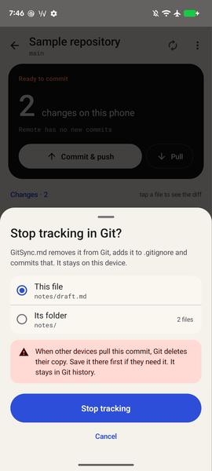
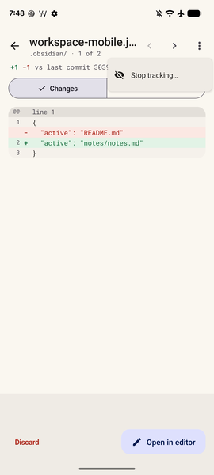

# Android: stop tracking a file, folder or Obsidian workspace files (issue #149, PR #150)

QA for the Android port of iOS "Stop Tracking…" (#132, PR #133). Stopping tracking removes the path from the Git index and keeps the file on disk. It adds a root-anchored entry to the root `.gitignore` and makes one commit holding only those two changes. Other staged changes stay staged.

## Results

| Check | Command | Result |
| --- | --- | --- |
| Android unit tests | `cd android && JAVA_HOME=$(/usr/libexec/java_home -v 17) ./gradlew test` | 1201 tests, 0 failures: core 763, app debug 219, app release 219 (`android-unit-tests.txt`) |
| New core tests | `StopTrackingPathTest` | 23/23. Mirrors `SyncMDTests/StopTrackingPathTests.swift`. Adds CRLF, nested `.gitignore`, uncommitted ignore rules, staged deletion, conflicts, unborn branch and a round trip through the #137 pull |
| New app tests | `StopTrackingViewModelTest` | 7/7. Covers options and counts, the commit as the vault author, typed errors, the Git tab suggestion and the entry-point rules |
| E2E, Changes long-press | `argent e2e run issue149-android-stop-tracking-changes-longpress --platform android --device <serial>` | PASS 17/17, twice; `check-result.sh file` PASS after each |
| E2E, diff overflow menu | `argent e2e run issue149-android-stop-tracking-diff-menu --platform android --device <serial>` | PASS 23/23, twice; `check-result.sh workspace` PASS after each |
| E2E, Git tab suggestion | `argent e2e run issue149-android-stop-tracking-git-suggestion --platform android --device <serial>` | PASS 16/16, twice; `check-result.sh workspace` PASS after each |
| Round trip to the receiving side (#137) | `issue137-android-pull-after-remote-stops-tracking` on `make-roundtrip.sh`'s scenario | PASS 8/8, 3 runs; pull `COMPLETED`; `check-roundtrip.sh` PASS |

Transcripts are in `runs/`, with one line per run in `runs/summary.txt`.

## What the device checks prove

`check-result.sh` copies the vault off the phone and checks it with desktop Git. HEAD's parent must be the base commit. The commit message must be the iOS text. `HEAD:.gitignore` must be exactly the new rule. The commit may change only `.gitignore` and the untracked paths. The untracked files must still be on disk with their local edits. `git status --ignored` must show them as ignored, and the other local edit must still be unstaged. The app's debug log recorded every run as `UNTRACK COMPLETED`.

Round trip: the phone's own stop-tracking commit (`.obsidian/workspace*.json`) was pushed to a remote, and the receiving vault was staged one commit behind it with a local edit to `.obsidian/workspace-mobile.json`. The receiving Pixel fast-forwarded to exactly that commit. It kept the edited file as an ignored file, without a local-changes block. As the sheet warns, Git deleted the workspace file it hadn't edited (`.obsidian/workspace.json`); Obsidian recreates it.

## Screenshots (Pixel 7, debug build)

| | |
| --- | --- |
|  |  |
|  |  |
|  |  |
|  |  |

Screenshots 1 to 6 were taken on the first build (`1e83da8c`). The second commit changes nothing visible: it exposes the vault tab ids and keeps the suggestion button enabled.

## Found and fixed during QA

- **The suggestion button swallowed a quick tap.** It was disabled while the Git tab read status on entry. It now stays enabled, as on iOS outside a sync; Git work is serialized per repository anyway.
- **The bottom tabs had no selectable ids.** Their test tags are now exposed as resource ids, so the tests use `vault-tab-git` rather than a coordinate.

## Environment and side effects

- Owner's Pixel 7 with the debug app `com.bontecou.syncmd.debug` at `cf3a9163`, installed with `adb -s <serial> install -r`.
- Scenario: `pixel-scenario/make-scenario.sh` builds a vault and an on-device bare remote in this folder's gitignored `scratch/`. The vault tracks notes and two workspace files and has local edits to `notes/draft.md` and `.obsidian/workspace-mobile.json`. `reset-scenario.sh <serial> [tar]` replaces the debug app's `files/sample-workspace` with it. Everything is fixture text; there is no personal data, no network and no accounts.
- The debug app's `files/sample-workspace` was backed up before the first run and restored afterwards. The restored copy was verified byte-identical. The app's other vault and the release app were not touched.
- **Coordinate exceptions: none.** Every tap and the long-press use ids or fixed text.

## Notes on the Argent runs

- During live recording on this phone, Argent's element tree often stayed on the previous screen after a navigation. It recovered only after `stop-all-simulator-servers` for the device; this is the same freeze noted in the #137 QA. The CLI replays were not affected. The tests gate every navigation on a destination element and then on `await: { idle: true }`.
- Some replays have an `idle` warning ("a small part of it was still changing") right after Home or the vault opens. The moving parts are the other vault's status and the line counts loading. The next action waits for its own element, so it doesn't depend on the settle.
- A few waits use fixture-fixed text (`2 edited`, `1 ahead`, the commit subject). They hold for this scenario only.

## Not covered

- Tablet and foldable list-detail layouts (`AdaptivePanes`, `AdaptiveDiffPane`). They use separate row components and don't offer Stop tracking yet. Follow-up.
- An iOS device pulling the Android commit. The receiving logic is shared with #137. It was checked on Android (round trip above) and by the iOS unit tests of #138.
- An Android emulator: the device pool was full with other sessions' devices, so the Pixel 7 run stands in for it.
