# Android: stop tracking a file, folder or Obsidian workspace files (issue #149, PR #150)

Merged to main in #150 as `02fef61398cb058572f05ce899c065411037ab8c` on 2026-11-26.

QA for the Android port of iOS "Stop Tracking…" (#132, PR #133), on the phone layout and on the tablet and foldable layouts. Stopping tracking removes the path from the Git index and keeps the file on disk. It adds a root-anchored entry to the root `.gitignore` and makes one commit holding only those two changes. Other staged changes stay staged.

## Results

| Check | Command | Result |
| --- | --- | --- |
| Android unit tests | `cd android && JAVA_HOME=$(/usr/libexec/java_home -v 17) ./gradlew test` | 1201 tests, 0 failures: core 763, app debug 219, app release 219 (`android-unit-tests.txt`) |
| New core tests | `StopTrackingPathTest` | 23/23. Mirrors `SyncMDTests/StopTrackingPathTests.swift`. Adds CRLF, nested `.gitignore`, uncommitted ignore rules, staged deletion, conflicts, unborn branch and a round trip through the #137 pull |
| New app tests | `StopTrackingViewModelTest` | 7/7. Covers options and counts, the commit as the vault author, typed errors, the Git tab suggestion and the entry-point rules |
| E2E, Changes long-press | `argent e2e run issue149-android-stop-tracking-changes-longpress --platform android --device <serial>` | PASS 17/17, twice; `check-result.sh file` PASS after each |
| E2E, diff overflow menu | `argent e2e run issue149-android-stop-tracking-diff-menu --platform android --device <serial>` | PASS 23/23, twice; `check-result.sh workspace` PASS after each |
| E2E, Git tab suggestion | `argent e2e run issue149-android-stop-tracking-git-suggestion --platform android --device <serial>` | PASS 16/16, twice; `check-result.sh workspace` PASS after each |
| E2E, tablet and foldable layouts | `argent e2e run issue149-android-stop-tracking-large-screen --platform android --device <serial>` | PASS 27/27, twice at 664 dp (Medium) and twice at 1080 dp (Expanded); `check-result.sh both` PASS after each |
| Round trip to the receiving side (#137) | `issue137-android-pull-after-remote-stops-tracking` on `make-roundtrip.sh`'s scenario | PASS 8/8, 3 runs; pull `COMPLETED`; `check-roundtrip.sh` PASS |

Transcripts are in `runs/`, with one line per run in `runs/summary.txt`. Everything was run again on the final commit `b65fe5bf`: the three phone tests twice each and the large-screen test four times (`runs/final-b65fe5bf/summary.txt`). The round trip ran on `cf3a9163`; the large-screen commit doesn't change the commit or pull code.

## What the device checks prove

`check-result.sh` copies the vault off the phone and checks it with desktop Git. HEAD's parent must be the base commit. The commit message must be the iOS text. `HEAD:.gitignore` must be exactly the new rule. The commit may change only `.gitignore` and the untracked paths. The untracked files must still be on disk with their local edits. `git status --ignored` must show them as ignored, and the other local edit must still be unstaged. The app's debug log recorded every run as `UNTRACK COMPLETED`.

Round trip: the phone's own stop-tracking commit (`.obsidian/workspace*.json`) was pushed to a remote, and the receiving vault was staged one commit behind it with a local edit to `.obsidian/workspace-mobile.json`. The receiving Pixel fast-forwarded to exactly that commit. It kept the edited file as an ignored file, without a local-changes block. As the sheet warns, Git deleted the workspace file it hadn't edited (`.obsidian/workspace.json`); Obsidian recreates it.

## Screenshots (Pixel 7, debug build)

| | |
| --- | --- |
| 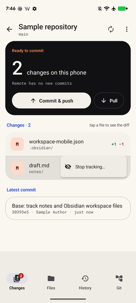 |  |
| 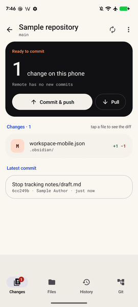 |  |
| 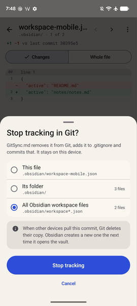 | 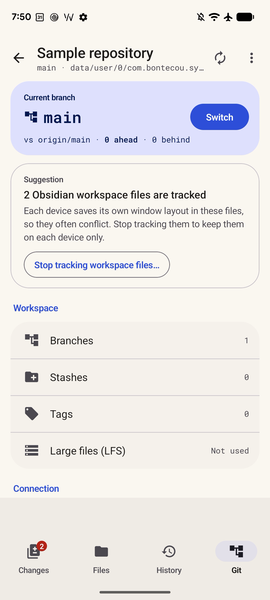 |
| 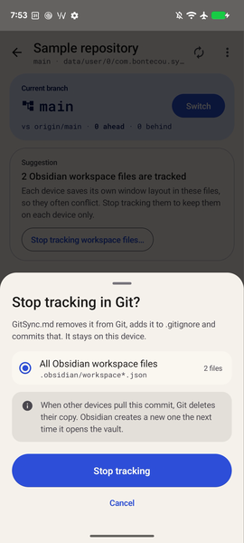 | 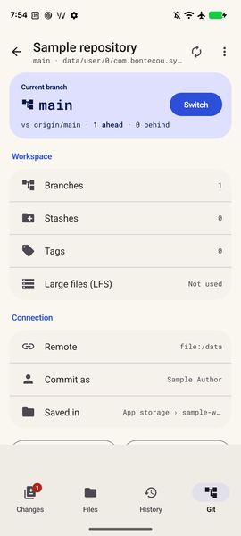 |

Screenshots 1 to 6 were taken on the first build (`1e83da8c`). The second commit changes nothing visible: it exposes the vault tab ids and keeps the suggestion button enabled.

### Tablet and foldable layouts

| | |
| --- | --- |
| 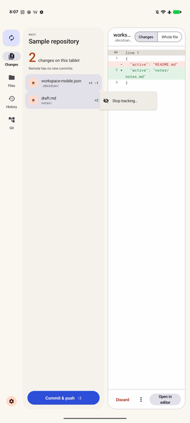 | 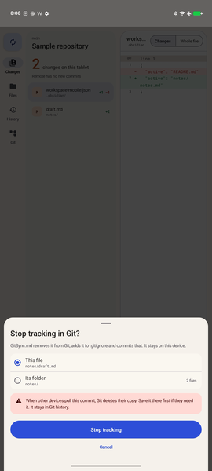 |
| 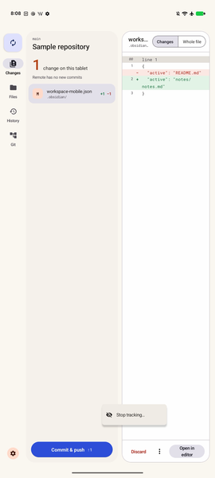 | 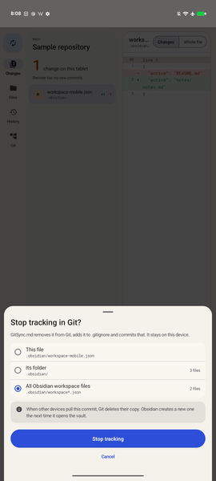 |
| 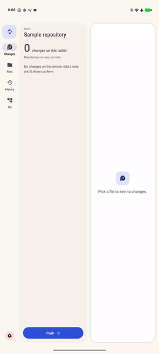 | 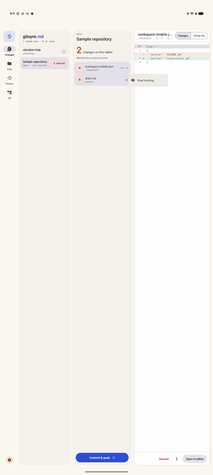 |

## Found and fixed during QA

- **The suggestion button swallowed a quick tap.** It was disabled while the Git tab read status on entry. It now stays enabled, as on iOS outside a sync; Git work is serialized per repository anyway.
- **The bottom tabs had no selectable ids.** Their test tags are now exposed as resource ids, so the tests use `vault-tab-git` rather than a coordinate.

## Tablet and foldable layouts

The adaptive vault offers the same action as the phone, with the same sheet and rules:
- **Changes pane** (list-detail on tablets and the foldable inner display): long-press a changed file › Stop tracking….
- **Diff pane:** "…" › Stop tracking…. In the list-detail pane it sits in the footer beside Discard, as iOS puts it beside Revert. On a 664 dp foldable-width window the header has no room left: a first build with "…" in the header squeezed the file name to nothing. In tabletop mode, which has no footer, it sits beside previous / next. After the commit the pane shows the next changed file, as after a discard.
- **Split screen** (a narrow window beside another app on a large screen): long-press a file row › Stop tracking….

How it was tested: no Android tablet or foldable is in the device pool, and other sessions' emulators were already over the Android boot limit. So the Pixel 7's display density was lowered with `adb shell wm density`: 260 gives a 664 dp window (Medium: rail, Changes, diff) and 160 gives 1080 dp (Expanded: rail, vault list, Changes, diff). It was reset afterwards (`wm density reset`, back to 420, also from a shell trap). The test long-presses `notes/draft.md` in the Changes pane and stops tracking it. It then uses the diff pane's "…" on `.obsidian/workspace-mobile.json` to stop tracking the workspace pattern. `check-result.sh both` then verifies the two commits on disk.

Not run on a device: tabletop and split screen, which need a real hinge or a large-screen multi-window session. Tabletop uses the same diff pane as the list-detail layout (only the "…" position differs). Split screen's long-press uses the same row menu and host as the Changes pane. Both compile and share the code paths tested above.

At 664 dp the diff pane footer is tight: "Open in editor" wraps to two lines next to Discard and "…". It is legible and doesn't overlap.

## Environment and side effects

- Owner's Pixel 7 with the debug app `com.bontecou.syncmd.debug` at `cf3a9163`, then `b65fe5bf`, installed with `adb -s <serial> install -r`. The display density was changed only for the large-screen runs and was reset afterwards.
- Scenario: `pixel-scenario/make-scenario.sh` builds a vault and an on-device bare remote in this folder's gitignored `scratch/`. The vault tracks notes and two workspace files and has local edits to `notes/draft.md` and `.obsidian/workspace-mobile.json`. `reset-scenario.sh <serial> [tar]` replaces the debug app's `files/sample-workspace` with it. Everything is fixture text; there is no personal data, no network and no accounts.
- The debug app's `files/sample-workspace` was backed up before the first run and restored afterwards. The restored copy was verified byte-identical. The app's other vault and the release app were not touched.
- **Coordinate exceptions: none.** Every tap and long-press uses ids or fixed text.

## Notes on the Argent runs

- During live recording on this phone, Argent's element tree often stayed on the previous screen after a navigation. It recovered only after `stop-all-simulator-servers` for the device; this is the same freeze noted in the #137 QA. The CLI replays were not affected. The tests gate every navigation on a destination element and then on `await: { idle: true }`.
- Some replays have an `idle` warning ("a small part of it was still changing") right after Home or the vault opens, in both layouts. The moving parts are the other vault's status and the line counts loading. The next action waits for its own element, so it doesn't depend on the settle.
- A few waits use fixture-fixed text (`2 edited`, `1 ahead`, the commit subject). They hold for this scenario only.

## Not covered

- Tabletop and split screen on a device (see above).
- An iOS device pulling the Android commit. The receiving logic is shared with #137. It was checked on Android (round trip above) and by the iOS unit tests of #138.
- An Android emulator or a real tablet: the device pool has none, and it was full with other sessions' devices. The Pixel 7 at lowered density stands in for them.
